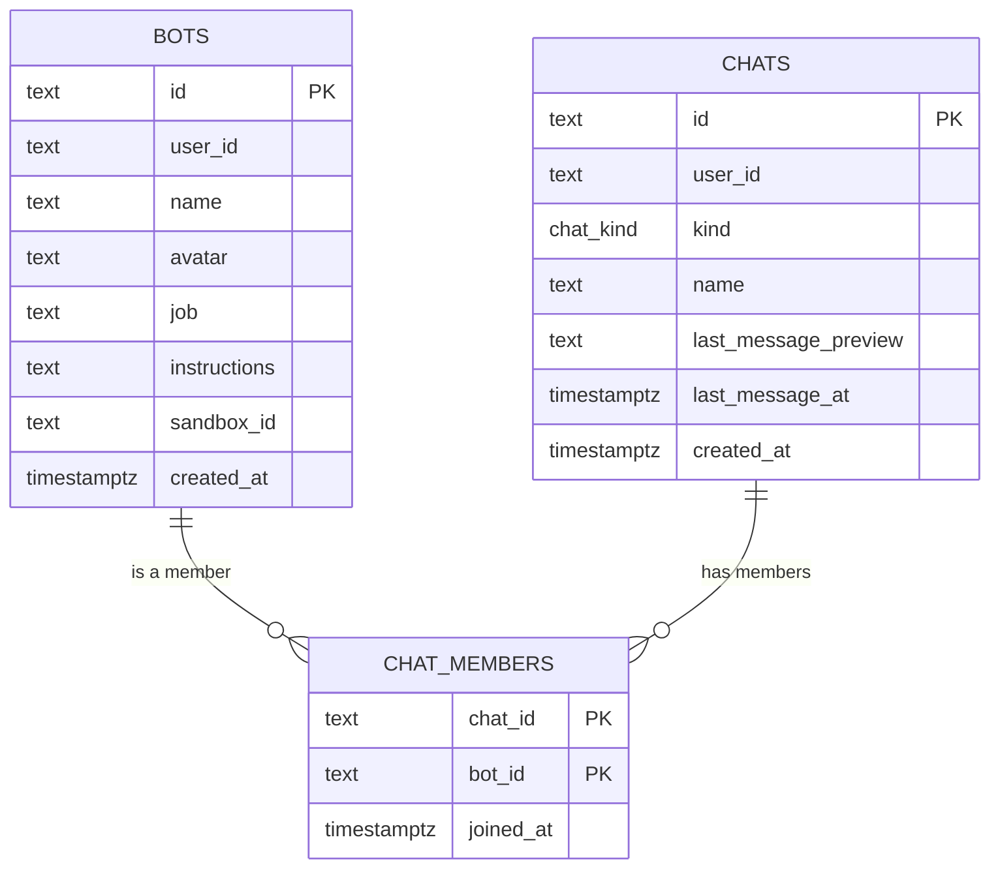

# Pandora

**A bot-powered chat workspace.** Give every bot a face, a name, and a job to do — then give it a space to work.


> **Status: early development.** Bot creation and persistence are implemented end to end. Messaging, chat navigation, and the bot runtime are next. The schema is still moving and development data is disposable.

## Overview

Pandora is a Next.js application for creating custom bots and talking to them in chats. Each bot carries a deterministic avatar, a job description, and free-form working instructions. Creating a bot also creates its direct chat and membership in one atomic database batch, so a bot is ready to receive messages as soon as it exists.

Authentication is handled by Clerk, data lives in Neon Postgres, and the UI is built with Tailwind CSS and shadcn/ui on Base UI.

## What works today

- **Authenticated workspace** — the home route is protected with `auth.protect()` and Clerk middleware in `proxy.ts`.
- **Bot creation dialog** — an accessible, dark-mode-ready dialog with validation, pending state, and error handling.
- **Bot presets** — Research assistant, Code reviewer, Writing editor, and Tutor fill the job and instructions in one click.
- **Faces** — deterministic DiceBear `gaze` avatars generated locally from a seed; Shuffle replaces the seed.
- **Shared validation** — one `drizzle-zod` insert schema powers both the client form and the server action.
- **Atomic creation** — a bot, its direct chat, and the `chatMembers` link are written in a single Neon HTTP batch.
- **Chat-ready data model** — direct and group conversations, ordered by `lastMessageAt`, with bot memberships and cascade cleanup.
- **Theme support** — system light/dark theme with `next-themes`; press `d` anywhere outside a field to toggle.

## Tech stack

| Layer      | Choice                                                            |
| ---------- | ----------------------------------------------------------------- |
| Framework  | Next.js 16 (App Router, React Server Components, Server Actions)  |
| UI         | React 19, Tailwind CSS 4, shadcn/ui (`base-nova` style), Base UI  |
| Auth       | Clerk 7 (`@clerk/nextjs`)                                         |
| Database   | Neon Postgres via `@neondatabase/serverless`                      |
| ORM        | Drizzle ORM (`neon-http` driver) + `drizzle-kit`                  |
| Validation | Zod 4 + `drizzle-zod`                                             |
| Forms      | React Hook Form + `@hookform/resolvers`                           |
| Avatars    | DiceBear 10 (`@dicebear/core` + `@dicebear/styles`, `gaze` style) |
| Icons      | Lucide                                                            |
| Tooling    | TypeScript, ESLint, Prettier, Tailwind Prettier plugin            |

## Architecture

```text
┌────────────────────────┐        ┌──────────────────────────┐
│  app/page.tsx (RSC)    │        │  components/bot-dialog    │
│  auth.protect()        │───────▶│  RHF + Zod + shadcn Field │
└────────────────────────┘        └────────────┬─────────────┘
                                               │ createBot(values)
                                               ▼
                                  ┌──────────────────────────┐
                                  │  actions/bot.ts          │
                                  │  auth() → userId         │
                                  │  schema.parse(input)     │
                                  └────────────┬─────────────┘
                                               │ db.batch([...])
                                               ▼
                                  ┌──────────────────────────┐
                                  │  Neon Postgres           │
                                  │  bots, chats, members    │
                                  └──────────────────────────┘
```

### Bot creation flow

1. The dialog validates input locally with `botsInsertSchema` and React Hook Form.
2. `createBot` resolves the Clerk `userId` on the server and rejects unauthenticated calls.
3. The action re-parses the input, generates the bot and chat IDs with `nanoid`, then runs three inserts through `db.batch`:
   - the bot row,
   - a `direct` chat owned by the same user,
   - the `chatMembers` row linking them.
4. The action returns `{ bot, chat }`; the dialog resets and closes.

The batch is the atomic unit because the `neon-http` driver does not support interactive transactions. Generating both IDs in the action makes it possible to reference them inside the same batch.

### Data model



Notes:

- `bots.user_id` and `chats.user_id` hold Clerk user IDs. There is no local users table and no foreign key to one.
- `chats.kind` is a Postgres enum: `direct` or `group`. Direct chats leave `name` null and render the bot's name instead.
- `chat_members` uses a composite primary key on `(chat_id, bot_id)`. Both foreign keys cascade on delete, and `bot_id` is indexed for reverse lookups.
- `last_message_at` and `last_message_preview` are ready for inbox ordering and previews once messages exist.
- `bots.sandbox_id` is reserved for a future execution runtime.
- `db/schema.ts` also exports Drizzle relations, so nested reads work: `db.query.chats.findMany({ with: { members: { with: { bot: true } } } })`.

## Getting started

### Prerequisites

- Node.js 22 or newer
- npm
- A [Neon](https://neon.tech) Postgres project
- A [Clerk](https://clerk.com) application (development instance is fine)

### 1. Install dependencies

```bash
npm install
```

If npm reports an `ERESOLVE` conflict around an optional `effect` peer dependency, install with:

```bash
npm install --legacy-peer-deps
```

### 2. Configure `.env.local`

Create `.env.local` in the project root:

```dotenv
# Neon
DATABASE_URL="postgresql://..."
DATABASE_URL_UNPOOLED="postgresql://..."
NEON_BRANCH="main"

# Clerk
NEXT_PUBLIC_CLERK_PUBLISHABLE_KEY="pk_test_..."
CLERK_SECRET_KEY="sk_test_..."
NEXT_PUBLIC_CLERK_SIGN_IN_URL="/sign-in"
NEXT_PUBLIC_CLERK_SIGN_UP_URL="/sign-up"
NEXT_PUBLIC_CLERK_SIGN_IN_FALLBACK_REDIRECT_URL="/"
NEXT_PUBLIC_CLERK_SIGN_UP_FALLBACK_REDIRECT_URL="/"
```

| Variable                                          | Required | Purpose                                                 |
| ------------------------------------------------- | -------- | ------------------------------------------------------- |
| `DATABASE_URL`                                    | Yes      | Pooled connection used by the app at runtime            |
| `DATABASE_URL_UNPOOLED`                           | Yes      | Direct connection used by `drizzle-kit push` and Studio |
| `NEXT_PUBLIC_CLERK_PUBLISHABLE_KEY`               | Yes      | Clerk client key                                        |
| `CLERK_SECRET_KEY`                                | Yes      | Clerk server key                                        |
| `NEXT_PUBLIC_CLERK_SIGN_IN_URL`                   | No       | Sign-in route, `/sign-in`                               |
| `NEXT_PUBLIC_CLERK_SIGN_UP_URL`                   | No       | Sign-up route, `/sign-up`                               |
| `NEXT_PUBLIC_CLERK_SIGN_IN_FALLBACK_REDIRECT_URL` | No       | Where to land after sign-in, `/`                        |
| `NEXT_PUBLIC_CLERK_SIGN_UP_FALLBACK_REDIRECT_URL` | No       | Where to land after sign-up, `/`                        |
| `NEON_BRANCH`                                     | No       | Target branch for the Neon CLI / branch workflow        |

### 3. Push the schema

```bash
npm run db:push
```

This project intentionally uses `drizzle-kit push` instead of migration files. Schema changes are applied directly and old development data is not preserved.

### 4. Run the app

```bash
npm run dev
```

Open [http://localhost:3000](http://localhost:3000), sign up, and create your first bot.

## Scripts

| Command             | Description                                   |
| ------------------- | --------------------------------------------- |
| `npm run dev`       | Start the Next.js dev server with Turbopack   |
| `npm run build`     | Create a production build                     |
| `npm run start`     | Run the production build                      |
| `npm run lint`      | Run ESLint                                    |
| `npm run typecheck` | Run `tsc --noEmit`                            |
| `npm run format`    | Format TypeScript and TSX files with Prettier |
| `npm run db:push`   | Push `db/schema.ts` to Neon                   |
| `npm run db:studio` | Open Drizzle Studio                           |

## Project structure

```text
app/
  page.tsx                    # Protected home / empty state
  layout.tsx                  # Clerk, theme, tooltip, and toast providers
  sign-in/[[...sign-in]]/     # Clerk sign-in route
  sign-up/[[...sign-up]]/     # Clerk sign-up route
  globals.css                 # Tailwind 4 theme tokens
actions/
  bot.ts                      # createBot server action (bot + chat + member)
components/
  bot-dialog.tsx              # Bot creation form and dialog
  chat-avatar.tsx             # DiceBear gaze avatar
  theme-provider.tsx          # next-themes + keyboard toggle
  ui/                         # shadcn/ui (Base UI) primitives
db/
  index.ts                    # Drizzle client (Neon HTTP)
  schema.ts                   # Tables, enum, insert schema, relations
hooks/                        # Shared React hooks
lib/                          # Utilities
proxy.ts                      # Clerk middleware (Next.js 16 proxy)
drizzle.config.ts             # drizzle-kit configuration
neon.ts                       # Neon CLI branch configuration
AGENTS.md                     # Development conventions
```

## Implementation notes

- **Auth is checked at the boundary.** Server actions are public endpoints; `createBot` calls `auth()` and throws unless a `userId` is present. The client never supplies its own user ID.
- **Validation lives next to the table.** `botsInsertSchema` is generated from `bots` with `drizzle-zod`, omits server-managed columns, and is shared by the form and action.
- **Forms follow the house pattern.** React Hook Form with `zodResolver`, shadcn `Field` primitives, `FieldError` for messages, `useWatch` for rendered values, and a reset when the dialog closes. See `AGENTS.md`.
- **The dialog owns its trigger.** `app/page.tsx` renders `<BotDialog />` rather than wiring open state itself.
- **UI components are Base UI primitives.** The project uses the shadcn `base-nova` style; components live in `components/ui`.
- **Avatars are generated locally.** `ChatAvatar` renders the DiceBear SVG as a data URI through `next/image`, so avatars work without an external avatar API.

## Current limitations

- There is no messages table, message transport, or chat UI yet. Newly created chats cannot be opened from the interface.
- The home page always shows the empty state; there is no bot or chat list.
- Bots are personas only. Nothing executes instructions or uses `bots.sandbox_id` yet.
- Authorization is enforced in application code. Postgres row-level security is not configured.
- There are no automated tests or CI workflows yet.

## Roadmap

### Next

- [ ] Chat sidebar listing direct and group chats, sorted by `lastMessageAt`
- [ ] `/chats/[chatId]` route with conversation history
- [ ] `messages` table plus composer and persistence
- [ ] Update `lastMessagePreview` and `lastMessageAt` when a message is sent
- [ ] Bot editing, deletion, and archive flows

### Chat experience

- [ ] Streaming bot responses
- [ ] Markdown rendering and syntax-highlighted code blocks
- [ ] Attachments and image uploads
- [ ] Typing and thinking indicators
- [ ] Unread counts and read receipts
- [ ] Search across chats and messages
- [ ] Message actions: copy, retry, delete

### Bots and automation

- [ ] Memory and persona editing
- [ ] Sandbox-backed tool execution using `bots.sandboxId`
- [ ] Tool permissions with explicit approval prompts
- [ ] Group chats with multiple bot members
- [ ] Reusable bot templates and presets

### Platform

- [ ] Per-user rate limits and usage quotas
- [ ] Realtime updates and optimistic message sending
- [ ] Unit, integration, and end-to-end tests with CI
- [ ] Structured logging and tracing
- [ ] Preview deployments backed by Neon branches
- [ ] Accessibility and mobile/PWA polish

## Contributing

This is a development project with no backwards-compatibility guarantees. Before changing schema or form code, read [`AGENTS.md`](./AGENTS.md) for the database, forms, Git, and DiceBear conventions.

Before opening a change, run:

```bash
npm run typecheck
npm run lint
npx prettier --check .
```

## Acknowledgements

Built with [Next.js](https://nextjs.org), [React](https://react.dev), [Tailwind CSS](https://tailwindcss.com), [shadcn/ui](https://ui.shadcn.com), [Base UI](https://base-ui.com), [Clerk](https://clerk.com), [Neon](https://neon.tech), [Drizzle ORM](https://orm.drizzle.team), [DiceBear](https://www.dicebear.com), and [Lucide](https://lucide.dev).
