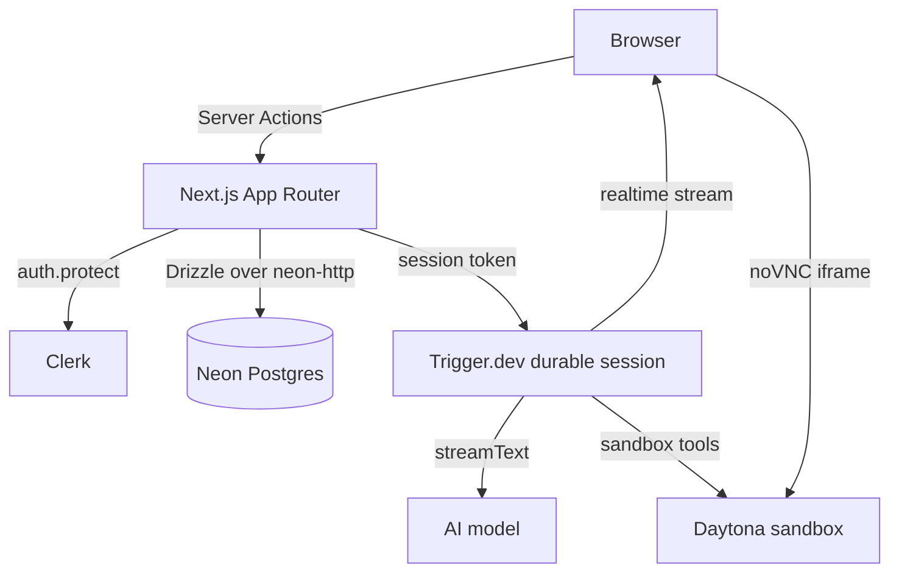

<div align="center">


# Pandora

**Give every bot a face, a job, and a place to work.**

Pandora is a chat workspace for custom AI bots. Each bot can have a distinct persona, avatar, and durable conversation in a shared workspace.

[![Next.js 16][next-shield]][next-url] [![React 19][react-shield]][react-url] [![TypeScript 5][ts-shield]][ts-url] [![Tailwind CSS 4][tailwind-shield]][tailwind-url] [![Clerk][clerk-shield]][clerk-url] [![Trigger.dev][trigger-shield]][trigger-url] [![Neon][neon-shield]][neon-url]

[Live demo](https://pandora-moirai2.vercel.app) · [Architecture](#architecture) · [Getting started](#getting-started) · [Project structure](#project-structure) · [CI/CD](#cicd)

</div>

> [!NOTE]
> Pandora is a TypeScript app built around durable chat sessions, bot personas, and sandboxed tool execution in a shared workspace.

## Overview

Pandora gives each bot a name, role, working instructions, and a deterministic avatar. Bots live in a workspace, can take part in direct or group chats, and keep a durable conversation thread keyed to their chat session.

The app is built with Next.js 16, React 19, and Tailwind CSS, and uses Clerk for authentication, Neon Postgres for data, Trigger.dev for the chat runtime, and Daytona sandboxes for live tool execution.

## Features

- Bot personas with a name, job, and persistent instructions
- Deterministic DiceBear avatars generated from stored seeds
- One-click presets for common bot roles
- Durable chat sessions with streaming replies and resume support
- Rich responses with Markdown, syntax-highlighted code, Mermaid diagrams, and reasoning output
- Copy and regenerate actions on messages
- Shared workspace with direct and group chats
- Sandbox tools for shell, file operations, and desktop interaction
- Live noVNC desktop panel for the bot's sandbox
- Command palette and sidebar chat browsing

## Tech stack

| Layer | Choice |
| --- | --- |
| Framework | Next.js 16 (App Router) |
| UI | React 19, Tailwind CSS 4, shadcn/ui, Base UI |
| Auth | Clerk |
| Database | Neon Postgres |
| ORM | Drizzle ORM |
| Validation | Zod 4 + drizzle-zod |
| Forms | React Hook Form + resolvers |
| Avatars | DiceBear 10 |
| AI | AI SDK with an OpenAI-compatible model |
| Chat runtime | Trigger.dev durable sessions |
| Sandboxes | Daytona |
| Tooling | TypeScript, ESLint, Prettier |

## Architecture

### Request path



### Bot lifecycle

1. A bot is created with a validated name, job, and instructions.
2. The action creates the bot record and its direct chat in a single batch.
3. A Daytona sandbox is created for the bot and linked to the record.
4. The chat runtime streams replies while the bot can use sandbox tools.
5. The workspace sidebar reads current chats and bot metadata for browsing.

## Getting started

### Prerequisites

- Node.js 20.9 or newer (22 LTS recommended)
- npm
- A Neon Postgres project
- A Clerk application
- A Trigger.dev project
- A Daytona account
- An API key for the chat model

### 1. Install dependencies

```bash
npm install
```

If npm reports an `ERESOLVE` conflict around an optional `effect` peer dependency, use:

```bash
npm install --legacy-peer-deps
```

### 2. Configure environment variables

Create a `.env.local` file in the project root:

```dotenv
# Neon
DATABASE_URL="postgresql://..."
DATABASE_URL_UNPOOLED="postgresql://..."
NEON_BRANCH="main"

# Clerk
NEXT_PUBLIC_CLERK_PUBLISHABLE_KEY="pk_test_..."
CLERK_SECRET_KEY="sk_test_..."
NEXT_PUBLIC_CLERK_SIGN_IN_URL="/sign-in"
NEXT_PUBLIC_CLERK_SIGN_UP_URL="/sign-up"
NEXT_PUBLIC_CLERK_SIGN_IN_FALLBACK_REDIRECT_URL="/"
NEXT_PUBLIC_CLERK_SIGN_UP_FALLBACK_REDIRECT_URL="/"

# Chat
TOKENHARBOR_API_KEY="..."
TRIGGER_SECRET_KEY="tr_dev_..."

# Sandboxes
DAYTONA_SECRET_KEY="..."
DAYTONA_API_URL="https://app.daytona.io/api"
DAYTONA_TARGET="us"
```

### 3. Push the schema

```bash
npm run db:push
```

### 4. Start the app and chat runtime

```bash
npm run dev
npx trigger.dev@latest dev
```

### 5. Create a bot

Open `http://localhost:3000`, sign in, and create a bot. You can use a preset, shuffle the avatar, and start a chat.

## Project structure

```text
app/
  (dashboard)/
    layout.tsx
    page.tsx
    chats/[chatId]/page.tsx
  sign-in/[[...sign-in]]/
  sign-up/[[...sign-up]]/
  layout.tsx
  globals.css
actions/
  bot.ts
  chat.ts
  desktop.ts
  group-chat.ts
components/
  app-sidebar.tsx
  bot-dialog.tsx
  chat.tsx
  chat-header.tsx
  chat-avatar.tsx
  chat-panels.tsx
  chat-desktop.tsx
  group-chat-dialog.tsx
  group-chat-avatar.tsx
  sidebar-chats.tsx
  ui/
db/
  index.ts
  schema.ts
hooks/
lib/
  ai.ts
  daytona.ts
queries/
  bots.ts
  chats.ts
trigger/
  chat.ts
  tools.ts
assets/readme/
public/
proxy.ts
next.config.ts
drizzle.config.ts
neon.ts
package.json
```

## Scripts

| Command | Description |
| --- | --- |
| `npm run dev` | Start the Next.js development server |
| `npm run build` | Create a production build |
| `npm run start` | Serve the production build |
| `npm run lint` | Run ESLint |
| `npm run typecheck` | Run `tsc --noEmit` |
| `npm run format` | Format TypeScript and TSX files with Prettier |
| `npm run db:push` | Push `db/schema.ts` to Neon |
| `npm run db:studio` | Open Drizzle Studio |
| `npx trigger.dev@latest dev` | Run the chat agent locally |

## CI/CD

The repository includes a GitHub Actions workflow that validates the app on every push and pull request:

- `npm ci`
- `npm run lint`
- `npm run typecheck`
- `npx prettier --check .`

This keeps the project aligned with the repository's existing contributor checks without requiring a production build in CI.

## License

Released under the [MIT License](./LICENSE).

<!-- Badges -->

[next-shield]: https://img.shields.io/badge/Next.js-16-000000?style=flat-square&logo=nextdotjs&logoColor=white
[next-url]: https://nextjs.org
[react-shield]: https://img.shields.io/badge/React-19-087EA4?style=flat-square&logo=react&logoColor=white
[react-url]: https://react.dev
[ts-shield]: https://img.shields.io/badge/TypeScript-5-3178C6?style=flat-square&logo=typescript&logoColor=white
[ts-url]: https://www.typescriptlang.org
[tailwind-shield]: https://img.shields.io/badge/Tailwind_CSS-4-06B6D4?style=flat-square&logo=tailwindcss&logoColor=white
[tailwind-url]: https://tailwindcss.com
[clerk-shield]: https://img.shields.io/badge/Clerk-7-6C47FF?style=flat-square&logo=clerk&logoColor=white
[clerk-url]: https://clerk.com
[neon-shield]: https://img.shields.io/badge/Neon-Postgres-00E599?style=flat-square&logo=neon&logoColor=black
[neon-url]: https://neon.tech
[trigger-shield]: https://img.shields.io/badge/Trigger.dev-4-41FFCA?style=flat-square&logo=triggerdotdev&logoColor=black
[trigger-url]: https://trigger.dev
