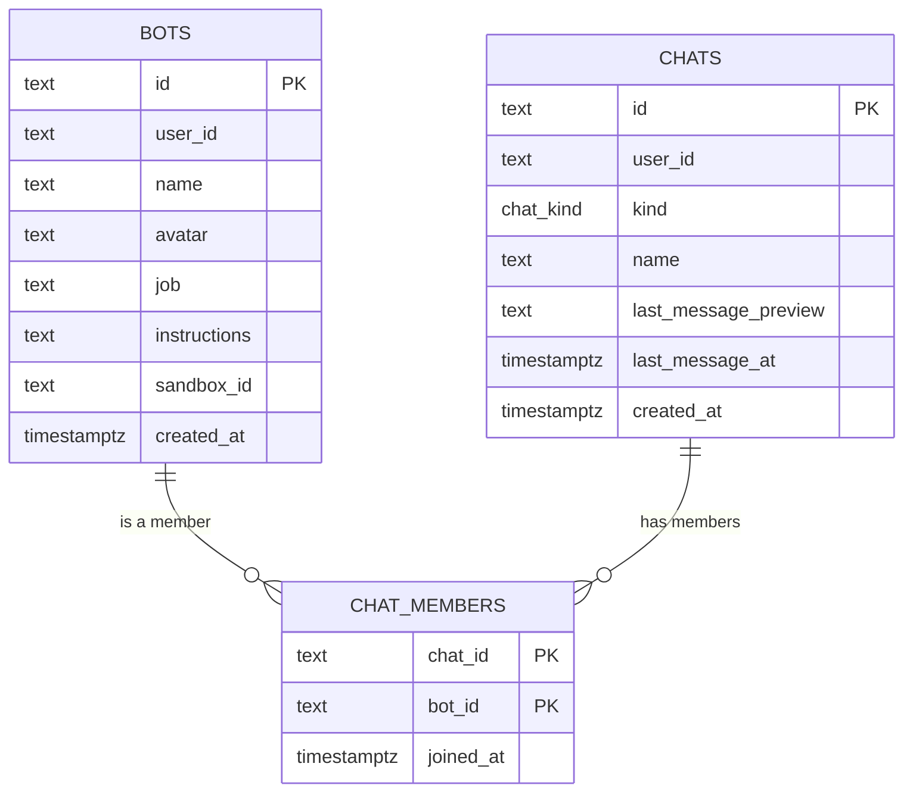

# Pandora

**A bot-powered chat workspace.** Give every bot a face, a role, and instructions, then give it a place to work.


> **Project status: early development.** Bot creation and chat provisioning are implemented end to end, and existing chats are listed in the sidebar. Messaging, chat navigation, and the bot runtime are not built yet. The database schema is still changing and development data is disposable.

## Contents

- [Overview](#overview)
- [Features](#features)
- [Tech stack](#tech-stack)
- [Architecture](#architecture)
- [Getting started](#getting-started)
- [Scripts](#scripts)
- [Project structure](#project-structure)
- [Development conventions](#development-conventions)
- [Current limitations](#current-limitations)
- [Roadmap](#roadmap)
- [Contributing](#contributing)
- [Acknowledgements](#acknowledgements)

## Overview

Pandora is a Next.js application for creating custom bots and talking to them in chats. Each bot has a deterministic avatar, a defined role, and free-form working instructions. Creating a bot also creates its direct chat and membership in one atomic database batch, so the bot is ready for a conversation as soon as it exists.

Authentication is handled by Clerk, data lives in Neon Postgres, and the interface is built with Tailwind CSS and shadcn/ui components on Base UI. Drizzle provides typed database access, including a single Zod schema shared by the client form and the server action.

The messaging layer is the next milestone. Today the application covers identity, bot creation, and the workspace shell that messaging will live in.

## Features

- **Authenticated workspace.** The application is protected by Clerk middleware and `auth.protect()`; the sidebar shows the signed-in user.
- **Bot creation.** A validated, accessible dialog captures a name, role, and working instructions, with pending state and server error handling.
- **Presets.** Research assistant, Code reviewer, Writing editor, and Tutor fill the role and instructions in one click. Presets still pass through validation.
- **Deterministic avatars.** Each bot stores a seed and renders a DiceBear `gaze` avatar locally as an SVG data URI. Shuffle generates a new seed.
- **Shared validation.** A single `drizzle-zod` insert schema (`botsInsertSchema`) powers both the React Hook Form resolver and the server action.
- **Atomic provisioning.** A bot, its direct chat, and the `chatMembers` link are written in one Neon HTTP batch.
- **Chat sidebar.** Chats are listed newest first, resolved to their bot name, avatar, and last-message preview, with a Suspense skeleton while loading.
- **Chat search.** `⌘K` / `Ctrl+K` opens a command dialog listing the user's chats.
- **Theming.** System light/dark theme via `next-themes`; press `d` outside a text field to toggle.

## Tech stack

| Layer      | Choice                                                            |
| ---------- | ----------------------------------------------------------------- |
| Framework  | Next.js 16 (App Router, React Server Components, Server Actions)  |
| UI         | React 19, Tailwind CSS 4, shadcn/ui (`base-nova` style), Base UI  |
| Auth       | Clerk 7 (`@clerk/nextjs`)                                         |
| Database   | Neon Postgres via `@neondatabase/serverless`                      |
| ORM        | Drizzle ORM (`neon-http` driver) + `drizzle-kit`                  |
| Validation | Zod 4 + `drizzle-zod`                                             |
| Forms      | React Hook Form + `@hookform/resolvers`                           |
| Avatars    | DiceBear 10 (`@dicebear/core` + `@dicebear/styles`, `gaze` style) |
| Icons      | Lucide                                                            |
| Tooling    | TypeScript, ESLint, Prettier, Tailwind Prettier plugin            |

## Architecture

### Route and data flow

```text
app/(dashboard)/layout.tsx
└── SidebarProvider
    ├── AppSidebar (client)
    │   ├── SidebarChats (RSC) ─────┐
    │   ├── CommandChats (RSC) ─────┤── getSidebarChats() ── Neon Postgres
    │   └── BotDialog ──▶ actions/bot.ts ──▶ db.batch([...])
    └── main
        └── app/(dashboard)/page.tsx (RSC, auth.protect())
            └── BotDialog
```

The sidebar and the command palette render as server components inside Suspense boundaries. Both call `getSidebarChats`, which is memoized with React `cache`, so a single request performs one query even though two components read the result.

### Bot creation flow

1. The dialog validates input locally with `botsInsertSchema` and React Hook Form.
2. `createBot` resolves the Clerk `userId` on the server and rejects unauthenticated calls.
3. The action re-parses the input and generates the bot and chat IDs with `nanoid`.
4. Three writes run through `db.batch`:
   - the bot row,
   - a `direct` chat owned by the same user,
   - the `chatMembers` row linking them.
5. The action returns `{ bot, chat }`. The dialog resets, closes, and refreshes the route so the sidebar picks up the new chat.

The batch is the atomic unit because the `neon-http` driver does not support interactive transactions. Both IDs are generated in the action so they can be referenced inside the same batch.

### Data model



- `bots.user_id` and `chats.user_id` hold Clerk user IDs. There is no local users table and no foreign key to one.
- `bots.avatar` stores a DiceBear seed, not an image.
- `chats.kind` is a Postgres enum with `direct` and `group` values. Direct chats leave `name` null and display the bot's name instead.
- `chat_members` uses a composite primary key on `(chat_id, bot_id)`. Both foreign keys cascade on delete, and `bot_id` is indexed for reverse lookups.
- `chats.last_message_at` defaults to the creation time, so new chats sort to the top of the sidebar. `last_message_preview` is ready for previews once messages exist.
- `bots.sandbox_id` is reserved for a future execution runtime.
- `db/schema.ts` also exports Drizzle relations, enabling nested reads such as `db.query.chats.findMany({ with: { members: { with: { bot: true } } } })`.

## Getting started

### Prerequisites

- Node.js 20.9 or newer (22 LTS recommended)
- npm
- A [Neon](https://neon.tech) Postgres project
- A [Clerk](https://clerk.com) application (a development instance is sufficient)

### 1. Install dependencies

```bash
npm install
```

If npm reports an `ERESOLVE` conflict around an optional `effect` peer dependency, install with:

```bash
npm install --legacy-peer-deps
```

### 2. Configure the environment

Create `.env.local` in the project root:

```dotenv
# Neon
DATABASE_URL="postgresql://..."
DATABASE_URL_UNPOOLED="postgresql://..."
NEON_BRANCH="main"

# Clerk
NEXT_PUBLIC_CLERK_PUBLISHABLE_KEY="pk_test_..."
CLERK_SECRET_KEY="sk_test_..."
NEXT_PUBLIC_CLERK_SIGN_IN_URL="/sign-in"
NEXT_PUBLIC_CLERK_SIGN_UP_URL="/sign-up"
NEXT_PUBLIC_CLERK_SIGN_IN_FALLBACK_REDIRECT_URL="/"
NEXT_PUBLIC_CLERK_SIGN_UP_FALLBACK_REDIRECT_URL="/"
```

| Variable                                          | Required | Purpose                                                 |
| ------------------------------------------------- | -------- | ------------------------------------------------------- |
| `DATABASE_URL`                                    | Yes      | Pooled connection used by the application at runtime    |
| `DATABASE_URL_UNPOOLED`                           | Yes      | Direct connection used by `drizzle-kit push` and Studio |
| `NEXT_PUBLIC_CLERK_PUBLISHABLE_KEY`               | Yes      | Clerk client key                                        |
| `CLERK_SECRET_KEY`                                | Yes      | Clerk server key                                        |
| `NEXT_PUBLIC_CLERK_SIGN_IN_URL`                   | No       | Sign-in route, `/sign-in`                               |
| `NEXT_PUBLIC_CLERK_SIGN_UP_URL`                   | No       | Sign-up route, `/sign-up`                               |
| `NEXT_PUBLIC_CLERK_SIGN_IN_FALLBACK_REDIRECT_URL` | No       | Redirect target after sign-in, `/`                      |
| `NEXT_PUBLIC_CLERK_SIGN_UP_FALLBACK_REDIRECT_URL` | No       | Redirect target after sign-up, `/`                      |
| `NEON_BRANCH`                                     | No       | Target branch for the Neon CLI / branch workflow        |

### 3. Push the schema

```bash
npm run db:push
```

This project uses `drizzle-kit push` instead of migration files. Schema changes are applied directly, and existing development data is not preserved.

### 4. Start the development server

```bash
npm run dev
```

Open [http://localhost:3000](http://localhost:3000), sign up, and create a bot.

## Scripts

| Command             | Description                                   |
| ------------------- | --------------------------------------------- |
| `npm run dev`       | Start the Next.js development server          |
| `npm run build`     | Create a production build                     |
| `npm run start`     | Serve the production build                    |
| `npm run lint`      | Run ESLint                                    |
| `npm run typecheck` | Run `tsc --noEmit`                            |
| `npm run format`    | Format TypeScript and TSX files with Prettier |
| `npm run db:push`   | Push `db/schema.ts` to Neon                   |
| `npm run db:studio` | Open Drizzle Studio                           |

## Project structure

```text
app/
  (dashboard)/
    layout.tsx                # Sidebar shell and Suspense boundaries
    page.tsx                  # Protected home route and empty state
  sign-in/[[...sign-in]]/     # Clerk sign-in route
  sign-up/[[...sign-up]]/     # Clerk sign-up route
  layout.tsx                  # Clerk, theme, tooltip, and toast providers
  globals.css                 # Tailwind 4 theme tokens
actions/
  bot.ts                      # createBot server action
components/
  app-sidebar.tsx             # Sidebar, navigation menu, search palette
  bot-dialog.tsx              # Bot creation form and dialog
  chat-avatar.tsx             # DiceBear avatar renderer
  sidebar-chats.tsx           # Sidebar and command-dialog chat lists
  theme-provider.tsx          # next-themes with keyboard toggle
  ui/                         # shadcn/ui (Base UI) primitives
db/
  index.ts                    # Drizzle client (Neon HTTP)
  schema.ts                   # Tables, enum, insert schema, relations
hooks/                        # Shared React hooks
lib/                          # Utilities
queries/
  bots.ts                     # Request-cached sidebar chat query
proxy.ts                      # Clerk middleware (Next.js 16 proxy)
drizzle.config.ts             # drizzle-kit configuration
neon.ts                       # Neon CLI branch configuration
AGENTS.md                     # Development conventions
```

## Development conventions

The full conventions live in [`AGENTS.md`](./AGENTS.md). In short:

- **Authorize at the boundary.** Server actions are public endpoints. Read `userId` from `auth()` and fail when it is missing; never accept a user ID from the client.
- **Define validation next to the table.** Generate insert schemas with `drizzle-zod`, omit server-managed columns, and share the schema between client and server.
- **Follow the form pattern.** React Hook Form with `zodResolver`, shadcn `Field` primitives, `FieldError` for messages, `useWatch` for rendered values, and a reset when the dialog closes.
- **Database changes use `db:push`.** Do not create migration files in this project.

## Current limitations

- There is no messages table, message transport, or chat route. Sidebar entries are display-only and cannot be opened.
- The home route always renders the empty state, even when chats already exist. There is no bot list, editing, or deletion flow.
- Group chat creation is a menu placeholder with no implementation.
- Bots are personas only. Instructions are stored, but nothing executes them, and `bots.sandbox_id` is unused.
- Authorization is enforced in application code. Postgres row-level security is not configured.
- There are no automated tests or CI workflows.

## Roadmap

### Near term

- [ ] `/chats/[chatId]` route with conversation history
- [ ] `messages` table, composer, and message persistence
- [ ] Sidebar navigation with active-chat state
- [ ] Update `lastMessagePreview` and `lastMessageAt` when a message is sent
- [ ] Bot editing, deletion, and archive flows
- [ ] Group chat creation with multiple bot members

### Chat experience

- [ ] Streaming bot responses
- [ ] Markdown rendering and syntax-highlighted code blocks
- [ ] Attachments and image uploads
- [ ] Typing and thinking indicators
- [ ] Unread counts and read receipts
- [ ] Search across chats and messages
- [ ] Message actions: copy, retry, delete

### Bots and automation

- [ ] Memory and persona editing
- [ ] Sandbox-backed tool execution using `bots.sandboxId`
- [ ] Tool permissions with explicit approval prompts
- [ ] Reusable bot templates

### Platform

- [ ] Per-user rate limits and usage quotas
- [ ] Realtime updates and optimistic message sending
- [ ] Unit, integration, and end-to-end tests with CI
- [ ] Structured logging and tracing
- [ ] Preview deployments backed by Neon branches
- [ ] Accessibility and mobile/PWA polish

## Contributing

This is a development project with no backwards-compatibility guarantees. Read [`AGENTS.md`](./AGENTS.md) before changing schema, forms, or Git workflow.

Before submitting a change, run:

```bash
npm run typecheck
npm run lint
npx prettier --check .
```

## Acknowledgements

Built with [Next.js](https://nextjs.org), [React](https://react.dev), [Tailwind CSS](https://tailwindcss.com), [shadcn/ui](https://ui.shadcn.com), [Base UI](https://base-ui.com), [Clerk](https://clerk.com), [Neon](https://neon.tech), [Drizzle ORM](https://orm.drizzle.team), [DiceBear](https://www.dicebear.com), and [Lucide](https://lucide.dev).
