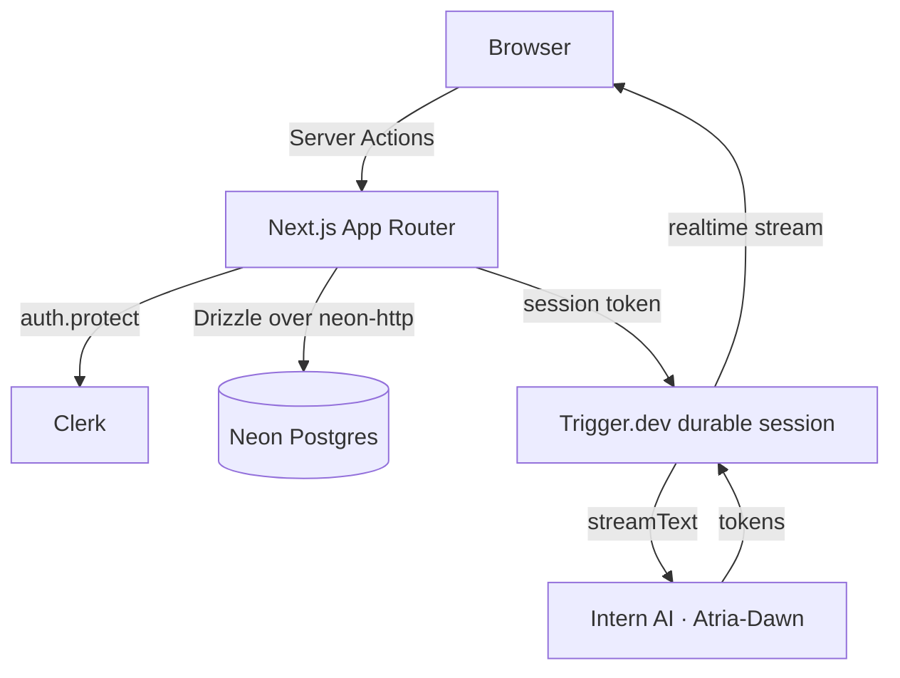
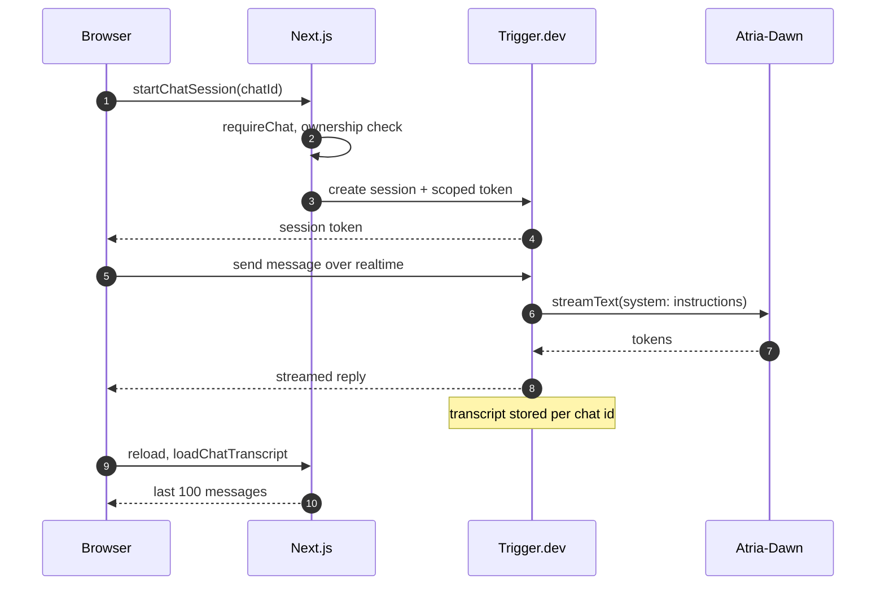
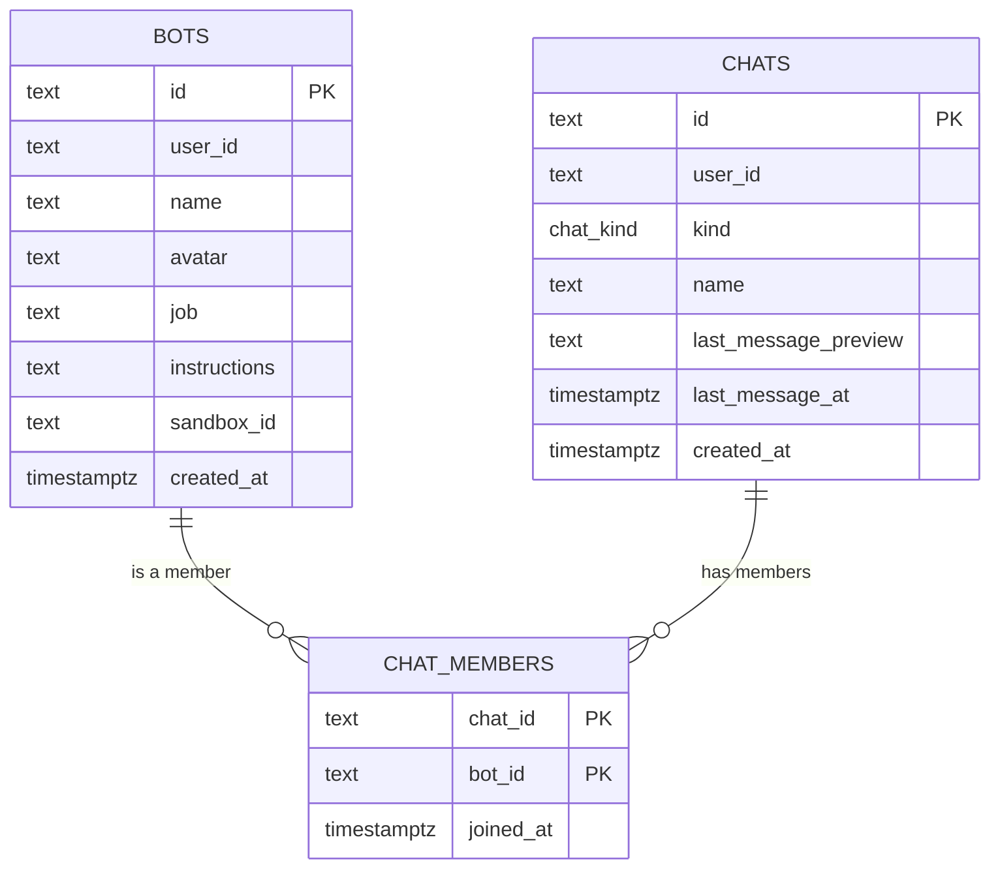

<div align="center">


# Pandora

**Give every bot a face, a job, and a place to work.**

Pandora is a chat workspace for custom AI bots. Give one a name, a role, and standing instructions, and it appears in your sidebar with a deterministic avatar and a durable conversation of its own.

[![Next.js 16][next-shield]][next-url] [![React 19][react-shield]][react-url] [![TypeScript 5][ts-shield]][ts-url] [![Tailwind CSS 4][tailwind-shield]][tailwind-url] [![Clerk][clerk-shield]][clerk-url] [![Neon Postgres][neon-shield]][neon-url] [![Trigger.dev][trigger-shield]][trigger-url] [![AI SDK 7][ai-sdk-shield]][ai-sdk-url]

[Features](#features) · [Architecture](#architecture) · [Getting started](#getting-started) · [Roadmap](#roadmap)

</div>

> [!WARNING]
> **Early development.** Bot creation, editing, and streaming chat work end to end. Group chats, attachments, and sandboxed tool execution do not. The schema changes freely and development data is disposable.

<details>
<summary>Contents</summary>

- [Overview](#overview)
- [Features](#features)
- [Tech stack](#tech-stack)
- [Architecture](#architecture)
- [Getting started](#getting-started)
- [Scripts](#scripts)
- [Project structure](#project-structure)
- [Development conventions](#development-conventions)
- [Current limitations](#current-limitations)
- [Roadmap](#roadmap)
- [Contributing](#contributing)
- [License](#license)
- [Acknowledgements](#acknowledgements)

</details>

## Overview

Each bot is a persona: a name, a job, free-form instructions, and an avatar generated from a stored seed. Creating a bot also creates its direct chat and membership in one atomic database batch, so the bot is ready to talk as soon as it exists.

The interface is built with Tailwind CSS 4 and shadcn/ui on Base UI, and is protected by Clerk. Bots and chats live in Neon Postgres behind Drizzle. Replies stream from a Trigger.dev durable session through the AI SDK, so a turn survives a refresh and a reconnect picks the answer back up.

The bot runtime is the next milestone. Instructions reach the model today, but sandboxed tool execution is not wired up yet.

## Features

| Area                      | What you get                                                                                                                                     |
| ------------------------- | ------------------------------------------------------------------------------------------------------------------------------------------------ |
| **Bot personas**          | A name, role, and working instructions, validated once in `db/schema.ts` and shared by the form and the server action.                           |
| **Deterministic avatars** | A DiceBear `gaze` face rendered locally from a stored seed. Shuffle picks a new seed; no image is ever uploaded.                                 |
| **One-click presets**     | Research assistant, code reviewer, writing editor, and tutor fill the form in a click, then still pass validation.                               |
| **Durable chat**          | Streaming replies in a Trigger.dev session with a stored transcript, a stop control, and resume after reload.                                    |
| **Rich responses**        | Markdown rendered with Streamdown, including syntax-highlighted code, math, Mermaid diagrams, and collapsible reasoning when the model emits it. |
| **Workspace sidebar**     | Chats ordered by activity with the bot's name, avatar, and stored message preview. Edit or delete a bot from its chat header.                    |
| **Command palette**       | `⌘K` / `Ctrl+K` searches your chats.                                                                                                             |
| **Theming**               | System light or dark theme via `next-themes`; press `d` outside a text field to toggle.                                                          |

## Tech stack

| Layer        | Choice                                                               |
| ------------ | -------------------------------------------------------------------- |
| Framework    | Next.js 16 (App Router, React Server Components, Server Actions)     |
| UI           | React 19, Tailwind CSS 4, shadcn/ui (`base-nova`), Base UI           |
| Auth         | Clerk 7 (`@clerk/nextjs`)                                            |
| Database     | Neon Postgres via `@neondatabase/serverless`                         |
| ORM          | Drizzle ORM (`neon-http`) + `drizzle-kit`                            |
| Validation   | Zod 4 + `drizzle-zod`                                                |
| Forms        | React Hook Form + `@hookform/resolvers`                              |
| Avatars      | DiceBear 10 (`@dicebear/core` + `@dicebear/styles`, `gaze`)          |
| AI           | AI SDK 7 against Intern AI's OpenAI-compatible endpoint (Atria-Dawn) |
| Chat runtime | Trigger.dev durable sessions (`chat.agent`)                          |
| Icons        | Lucide                                                               |
| Tooling      | TypeScript, ESLint, Prettier, Tailwind Prettier plugin               |

## Architecture

### Request path



The sidebar and command palette are server components inside Suspense boundaries. Both call `getSidebarChats`, memoized with React `cache`, so one request performs one query even though two components read the result.

### A chat turn



### Bot creation flow

1. The dialog validates input locally with `botsInsertSchema` and React Hook Form.
2. `createBot` resolves the Clerk `userId` on the server and rejects unauthenticated calls.
3. The action re-parses the input and generates the bot and chat IDs with `nanoid`.
4. Three writes run through `db.batch`: the bot row, a `direct` chat owned by the same user, and the `chatMembers` row linking them.
5. The action returns `{ bot, chat }`. The dialog resets, closes, and refreshes the route so the sidebar picks up the new chat.

The batch is the atomic unit because the `neon-http` driver does not support interactive transactions. Both IDs are generated in the action so they can be referenced inside the same batch.

### Data model

<details>
<summary>Entity diagram and column notes</summary>



- `bots.user_id` and `chats.user_id` hold Clerk user IDs. There is no local users table and no foreign key to one.
- `bots.avatar` stores a DiceBear seed, not an image.
- `chats.kind` is a Postgres enum with `direct` and `group` values. Direct chats leave `name` null and display the bot's name instead.
- `chat_members` uses a composite primary key on `(chat_id, bot_id)`. Both foreign keys cascade on delete, and `bot_id` is indexed for reverse lookups.
- `chats.last_message_at` defaults to the creation time, so new chats sort to the top of the sidebar. `last_message_preview` is ready for previews, but nothing writes to it yet.
- `bots.sandbox_id` is reserved for a future execution runtime.
- Messages are not stored here. The Trigger.dev transcript keyed by chat id is the source of truth.
- `db/schema.ts` also exports Drizzle relations, enabling nested reads such as `db.query.chats.findMany({ with: { members: { with: { bot: true } } } })`.

</details>

## Getting started

### Prerequisites

- Node.js 20.9 or newer (22 LTS recommended)
- npm
- A [Neon](https://neon.tech) Postgres project
- A [Clerk](https://clerk.com) application (a development instance is sufficient)
- A [Trigger.dev](https://trigger.dev) project
- An Intern AI API key for the chat model

### 1. Install dependencies

```bash
npm install
```

If npm reports an `ERESOLVE` conflict around an optional `effect` peer dependency, install with `npm install --legacy-peer-deps`.

### 2. Configure the environment

Create `.env.local` in the project root:

```dotenv
# Neon
DATABASE_URL="postgresql://..."
DATABASE_URL_UNPOOLED="postgresql://..."
NEON_BRANCH="main"

# Clerk
NEXT_PUBLIC_CLERK_PUBLISHABLE_KEY="pk_test_..."
CLERK_SECRET_KEY="sk_test_..."
NEXT_PUBLIC_CLERK_SIGN_IN_URL="/sign-in"
NEXT_PUBLIC_CLERK_SIGN_UP_URL="/sign-up"
NEXT_PUBLIC_CLERK_SIGN_IN_FALLBACK_REDIRECT_URL="/"
NEXT_PUBLIC_CLERK_SIGN_UP_FALLBACK_REDIRECT_URL="/"

# Chat
INTERN_AI_API_KEY="..."
TRIGGER_SECRET_KEY="tr_dev_..."
```

<details>
<summary>Environment variable reference</summary>

| Variable                                          | Required | Purpose                                                 |
| ------------------------------------------------- | -------- | ------------------------------------------------------- |
| `DATABASE_URL`                                    | Yes      | Pooled connection used by the application at runtime    |
| `DATABASE_URL_UNPOOLED`                           | Yes      | Direct connection used by `drizzle-kit push` and Studio |
| `NEXT_PUBLIC_CLERK_PUBLISHABLE_KEY`               | Yes      | Clerk client key                                        |
| `CLERK_SECRET_KEY`                                | Yes      | Clerk server key                                        |
| `INTERN_AI_API_KEY`                               | Yes      | Intern AI key used by the chat model                    |
| `TRIGGER_SECRET_KEY`                              | Yes      | Trigger.dev server key for the chat runtime             |
| `NEXT_PUBLIC_CLERK_SIGN_IN_URL`                   | No       | Sign-in route, `/sign-in`                               |
| `NEXT_PUBLIC_CLERK_SIGN_UP_URL`                   | No       | Sign-up route, `/sign-up`                               |
| `NEXT_PUBLIC_CLERK_SIGN_IN_FALLBACK_REDIRECT_URL` | No       | Redirect target after sign-in, `/`                      |
| `NEXT_PUBLIC_CLERK_SIGN_UP_FALLBACK_REDIRECT_URL` | No       | Redirect target after sign-up, `/`                      |
| `NEON_BRANCH`                                     | No       | Target branch for the Neon CLI / branch workflow        |

</details>

`trigger.config.ts` points at this repository's Trigger.dev project. Replace its `project` value with your own before deploying.

### 3. Push the schema

```bash
npm run db:push
```

This project uses `drizzle-kit push` instead of migration files. Schema changes are applied directly, and existing development data is not preserved.

### 4. Start the app and the chat runtime

```bash
npm run dev
npx trigger.dev@latest dev
```

The Trigger.dev CLI signs in and links the project on first run. Chat replies need it; bot creation does not.

### 5. Create a bot

Open [http://localhost:3000](http://localhost:3000), sign up, and create a bot. Pick a preset to fill the form, shuffle the avatar, and say hello.

## Scripts

| Command                      | Description                                   |
| ---------------------------- | --------------------------------------------- |
| `npm run dev`                | Start the Next.js development server          |
| `npm run build`              | Create a production build                     |
| `npm run start`              | Serve the production build                    |
| `npm run lint`               | Run ESLint                                    |
| `npm run typecheck`          | Run `tsc --noEmit`                            |
| `npm run format`             | Format TypeScript and TSX files with Prettier |
| `npm run db:push`            | Push `db/schema.ts` to Neon                   |
| `npm run db:studio`          | Open Drizzle Studio                           |
| `npx trigger.dev@latest dev` | Run the chat agent locally                    |

## Project structure

<details>
<summary>Source map</summary>

```text
app/
  (dashboard)/
    layout.tsx                # Sidebar shell and Suspense boundaries
    page.tsx                  # Protected home route and empty state
    chats/[chatId]/page.tsx   # Chat route with header and conversation
  sign-in/[[...sign-in]]/     # Clerk sign-in route
  sign-up/[[...sign-up]]/     # Clerk sign-up route
  layout.tsx                  # Clerk, theme, tooltip, and toast providers
  globals.css                 # Tailwind 4 theme tokens
actions/
  bot.ts                      # createBot, updateBot, deleteBot
  chat.ts                     # Session start, token minting, transcript load
components/
  app-sidebar.tsx             # Sidebar, navigation menu, search palette
  bot-dialog.tsx              # Create, edit, and delete bot form
  chat.tsx                    # Streaming conversation, resume, stop
  chat-header.tsx             # Bot identity and edit trigger
  chat-avatar.tsx             # DiceBear avatar renderer
  sidebar-chats.tsx           # Sidebar and command-dialog chat lists
  ai-elements/                # Conversation, message, prompt, reasoning
  ui/                         # shadcn/ui (Base UI) primitives
db/
  index.ts                    # Drizzle client (Neon HTTP)
  schema.ts                   # Tables, enum, insert schema, relations
hooks/                        # Shared React hooks
lib/
  ai.ts                       # Intern AI provider and chat model
queries/
  bots.ts                     # Request-cached sidebar chats
  chats.ts                    # Request-cached chat lookup
trigger/
  chat.ts                     # Durable chat agent definition
assets/readme/                # Avatars used in this document
proxy.ts                      # Clerk middleware (Next.js 16 proxy)
drizzle.config.ts             # drizzle-kit configuration
neon.ts                       # Neon CLI branch configuration
AGENTS.md                     # Development conventions
```

</details>

## Development conventions

The full conventions live in [`AGENTS.md`](./AGENTS.md). In short:

- **Authorize at the boundary.** Server actions are public endpoints. Read `userId` from `auth()` and fail when it is missing; never accept a user ID from the client.
- **Define validation next to the table.** Generate insert schemas with `drizzle-zod`, omit server-managed columns, and share the schema between client and server.
- **Follow the form pattern.** React Hook Form with `zodResolver`, shadcn `Field` primitives, `FieldError` for messages, `useWatch` for rendered values, and a reset when the dialog closes.
- **Database changes use `db:push`.** Do not create migration files in this project.

## Current limitations

- Transcripts are stored by Trigger.dev, not Postgres, and only the most recent 100 messages load into the chat.
- Sending a message does not update `chats.last_message_preview` or `last_message_at`, so sidebar previews and ordering go stale.
- Group chat creation is a menu placeholder, and the desktop-view button in the chat header is inert.
- Bots are personas only. Instructions reach the model as a system prompt; nothing executes them, and `bots.sandbox_id` is unused.
- There are no attachments or image uploads.
- Authorization is enforced in application code. Postgres row-level security is not configured.
- There are no automated tests or CI workflows.

## Roadmap

<details>
<summary>Planned work</summary>

### Near term

- [ ] Persist message previews and recency so the sidebar stays accurate
- [ ] Group chat creation with multiple bot members
- [ ] Bot list, archive, and restore flows
- [ ] Message actions: copy, retry, delete
- [ ] Search across message content, not just chat names

### Chat experience

- [ ] Attachments and image uploads
- [ ] Typing and thinking indicators
- [ ] Unread counts and read receipts
- [ ] Collapsible message history and pagination beyond 100 messages

### Bots and automation

- [ ] Memory and persona editing
- [ ] Sandbox-backed tool execution using `bots.sandboxId`
- [ ] Tool permissions with explicit approval prompts
- [ ] Reusable bot templates

### Platform

- [ ] Per-user rate limits and usage quotas
- [ ] Optimistic message sending
- [ ] Unit, integration, and end-to-end tests with CI
- [ ] Structured logging and tracing
- [ ] Preview deployments backed by Neon branches
- [ ] Accessibility and mobile/PWA polish

</details>

## Contributing

This is a development project with no backwards-compatibility guarantees. Read [`AGENTS.md`](./AGENTS.md) before changing schema, forms, or Git workflow.

Before submitting a change, run:

```bash
npm run typecheck
npm run lint
npx prettier --check .
```

## License

Released under the [MIT License](./LICENSE).

## Acknowledgements

Built with [Next.js](https://nextjs.org), [React](https://react.dev), [Tailwind CSS](https://tailwindcss.com), [shadcn/ui](https://ui.shadcn.com), [Base UI](https://base-ui.com), [Clerk](https://clerk.com), [Neon](https://neon.tech), [Drizzle ORM](https://orm.drizzle.team), [DiceBear](https://www.dicebear.com), [Trigger.dev](https://trigger.dev), [Vercel AI SDK](https://ai-sdk.dev), and [Lucide](https://lucide.dev).

<!-- Badges -->

[next-shield]: https://img.shields.io/badge/Next.js-16-000000?style=flat-square&logo=nextdotjs&logoColor=white
[next-url]: https://nextjs.org
[react-shield]: https://img.shields.io/badge/React-19-087EA4?style=flat-square&logo=react&logoColor=white
[react-url]: https://react.dev
[ts-shield]: https://img.shields.io/badge/TypeScript-5-3178C6?style=flat-square&logo=typescript&logoColor=white
[ts-url]: https://www.typescriptlang.org
[tailwind-shield]: https://img.shields.io/badge/Tailwind_CSS-4-06B6D4?style=flat-square&logo=tailwindcss&logoColor=white
[tailwind-url]: https://tailwindcss.com
[clerk-shield]: https://img.shields.io/badge/Clerk-7-6C47FF?style=flat-square&logo=clerk&logoColor=white
[clerk-url]: https://clerk.com
[neon-shield]: https://img.shields.io/badge/Neon-Postgres-00E599?style=flat-square&logo=neon&logoColor=black
[neon-url]: https://neon.tech
[trigger-shield]: https://img.shields.io/badge/Trigger.dev-4-41FFCA?style=flat-square&logo=triggerdotdev&logoColor=black
[trigger-url]: https://trigger.dev
[ai-sdk-shield]: https://img.shields.io/badge/AI_SDK-7-000000?style=flat-square&logo=vercel&logoColor=white
[ai-sdk-url]: https://ai-sdk.dev
